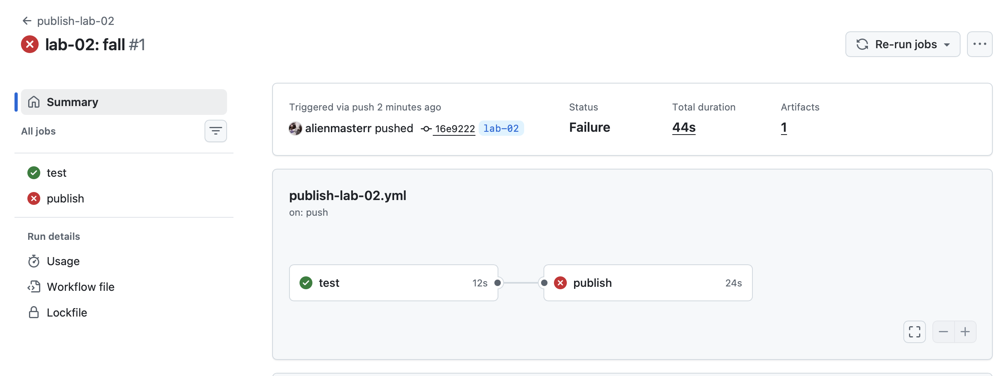

# return "ok\n"

((.venv) ) alina@MacBook-Air-Alina lab-02 % time ./.venv/bin/python -m pytest tests -q
.......                                                                                                            [100%]
7 passed, 1 warning in 0.03s
./.venv/bin/python -m pytest tests -q  0.35s user 0.10s system 38% cpu 1.167 total

# return "OK\n"

E       AssertionError: assert 'OK\n' == 'ok\n'
E         
E         - ok
E         + OK
FAILED tests/test_health.py::test_health_body_and_status - AssertionError: assert 'OK\n' == 'ok\n'
1 failed, 6 passed, 1 warning in 0.10s

time on 7 tests ±0.34s

((.venv) ) alina@MacBook-Air-Alina catshop-labs % curl localhost:8080/health
ok
((.venv) ) alina@MacBook-Air-Alina catshop-labs % curl localhost:8080/visits
{"store":"file","visits":1}

# no permissions
    permissions:
      contents: read
      packages: write

buildx failed with: ERROR: failed to build: failed to solve: failed to push ghcr.io/alienmasterr/marsik-shop:sha-16e922278a448de4f18971b7bf878ce0fc6bdcda: denied: installation not allowed to Create organization package

